# Applications for Xenia: assets

Every image behind [Applications for Xenia](https://highestinthesky.github.io/applications-for-xenia/), a website that sets scenes from Homer's *Odyssey* against 2025–26 U.S. immigration policy.

- `originals/` holds the source images from the design document, unchanged, plus the found metal photographs.
- `on-site/` holds the versions the site uses, cut, cleaned or recolored from those originals.
- `previews/` holds the small copies shown on this page.

## About these credits

This page lists everything known about each image. **"Not recorded" means the source was not written down when the image was collected, so the creator could not be credited.** "Appears to be" means the source was identified afterward and has not been confirmed. Nothing here grants permission to reuse an image, and removing a watermark does not license one.

If you made one of these images and want it credited differently or removed, please open an issue.

## Identified sources

| Preview | File | Use | Source | License |
| --- | --- | --- | --- | --- |
| 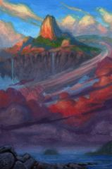 | [`aeolia-base.png`](originals/full-vision/aeolia-base.png) | Base painting for the floating island. Cut into `island-*`, `sky-*` and `bank-*` (day and night). | *Aeolia* by Nicholas Elias, gouache on paper: [Every Day Original](https://everydayoriginal.com/product/aeolia/) | Copyright the artist. **Permission not confirmed.** |
| 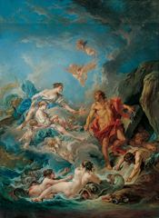 | [`aeolus-theme-ref.png`](originals/full-vision/aeolus-theme-ref.png) | Color reference for Aeolus. Not on the site. | Appears to be François Boucher, *Juno Asking Aeolus to Release the Winds*, 1769, Kimbell Art Museum: [Google Arts & Culture](https://artsandculture.google.com/asset/juno-asking-aeolus-to-release-the-winds/6gEMtzaaOYLSnA). Image file source not recorded. | Painting is in the public domain by age |
| 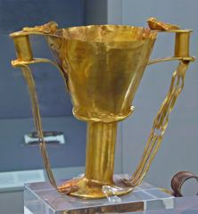 | [`gift-cup.png`](originals/full-vision/gift-cup.png) | Golden cup among Ithaca's gifts. Cut into `gift-cup`. | Appears to be Nestor's Cup, Mycenae, National Archaeological Museum, Athens. Museum photo; photographer not recorded. | Unconfirmed |
|  | [`i589-page-1.png`](originals/full-vision/i589-page-1.png) | Reference for the Asylum form. Not on the site. | U.S. Citizenship and Immigration Services, [Form I-589](https://www.uscis.gov/i-589) | U.S. government work |
| 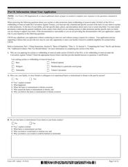 | [`i589-page-5.png`](originals/full-vision/i589-page-5.png) | Reference for the Asylum form. Not on the site. | U.S. Citizenship and Immigration Services, [Form I-589](https://www.uscis.gov/i-589) | U.S. government work |
| 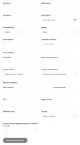 | [`goldcard-app-screenshot.png`](originals/full-vision/goldcard-app-screenshot.png) | Reference for the Gold Card form. Not on the site. | Screenshot of the application at [trumpcard.gov](https://trumpcard.gov) | U.S. government site; terms not checked |

## Real metal backgrounds (used on the Gold Card)

| Preview | File | Use | Source | License |
| --- | --- | --- | --- | --- |
| 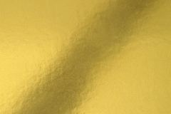 | [`metal-gold-unsplash-Em96eDRJPD8.jpg`](originals/metal/metal-gold-unsplash-Em96eDRJPD8.jpg) | `plate-gold`, cropped to 2880x1620 | Katie Harp, [Unsplash](https://unsplash.com/photos/gold-metallic-foil-texture-background-Em96eDRJPD8) | Unsplash License |
| 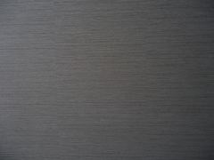 | [`metal-silver-unsplash-kRO-eKzSonM.jpg`](originals/metal/metal-silver-unsplash-kRO-eKzSonM.jpg) | `plate-silver`, cropped to 2880x1620 | engin akyurt, [Unsplash](https://unsplash.com/photos/a-close-up-of-a-grey-surface-kRO-eKzSonM) | Unsplash License |
| 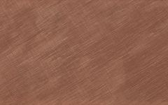 | [`metal-bronze-unsplash-vH3aPZM-3Rc.jpg`](originals/metal/metal-bronze-unsplash-vH3aPZM-3Rc.jpg) | `plate-bronze`, cropped to 2880x1620. Listed as brushed copper. | Fátima Frade Reis, 2017, via Europeana, [Unsplash](https://unsplash.com/photos/brushed-copper-surface-with-diagonal-lines-vH3aPZM-3Rc) | Unsplash License; public domain per the page |
| 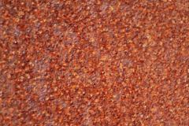 | [`metal-rust-commons-Rust_texture.jpg`](originals/metal/metal-rust-commons-Rust_texture.jpg) | `plate-rusted`, cropped to 2880x1620. The crop is shared under the same license. | Soapy Parrot, [Wikimedia Commons](https://commons.wikimedia.org/wiki/File:Rust_texture.jpg) | [CC BY-SA 4.0](https://creativecommons.org/licenses/by-sa/4.0/) |

## AI-generated images (replaced, no longer on the site)

| Preview | File | Use | Source | License |
| --- | --- | --- | --- | --- |
| 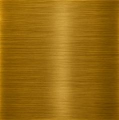 | [`plate-1.png`](originals/full-vision/plate-1.png) | Earlier gold background | AI-generated, per the author's design notes. Tool not recorded. | AI-generated |
| 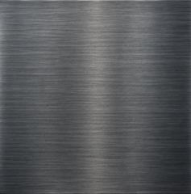 | [`plate-2.png`](originals/full-vision/plate-2.png) | Earlier silver background | AI-generated, per the author's design notes. Tool not recorded. | AI-generated |
| 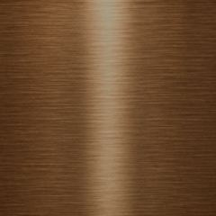 | [`plate-3-bronze.png`](originals/full-vision/plate-3-bronze.png) | Earlier bronze background | AI-generated, per the author's design notes. Tool not recorded. | AI-generated |
| 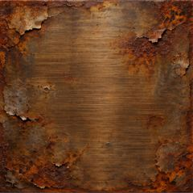 | [`plate-4.png`](originals/full-vision/plate-4.png) | Earlier rusted background | AI-generated, per the author's design notes. Tool not recorded. | AI-generated |

## Watermark removed or present in the original, source not recorded

| Preview | File | Use | Source | License |
| --- | --- | --- | --- | --- |
| 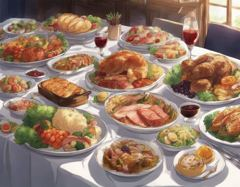 | [`feast-dishes.png`](originals/full-vision/feast-dishes.png) | Dishes in the Aeolus feast. Cut into `dish-1` to `dish-3`. | Not recorded. File metadata shows a watermark remover (PixelBin.io) was used. | Unconfirmed |
| 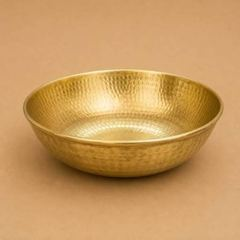 | [`gift-bowl.jpeg`](originals/full-vision/gift-bowl.jpeg) | Golden bowl among Ithaca's gifts. Cut into `gift-bowl`. | Not recorded. File metadata shows a watermark remover (PixelBin.io) was used. | Unconfirmed |
| 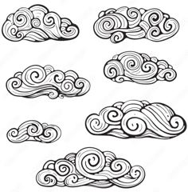 | [`cloud-b.png`](originals/full-vision/cloud-b.png) | Line clouds. Cut and recolored into `cloud-day-*` and `cloud-mist-*`. | Not recorded. Stock image with a watermark. | Unconfirmed |
|  | [`calendar.png`](originals/full-vision/calendar.png) | Tear-off calendar. Cut into `calendar-base` and `calendar-page`. | Not recorded. Stock image with a watermark. | Unconfirmed |

## Source not recorded

| Preview | File | Use | Source | License |
| --- | --- | --- | --- | --- |
|  | [`stamp-a.png`](originals/full-vision/stamp-a.png) | `stamp-approved` | Not recorded | Unconfirmed |
|  | [`stamp-b.png`](originals/full-vision/stamp-b.png) | `stamp-rejected` | Not recorded | Unconfirmed |
|  | [`stamp-c.png`](originals/full-vision/stamp-c.png) | `stamp-pending` | Not recorded | Unconfirmed |
| 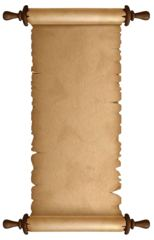 | [`parchment-scroll.png`](originals/full-vision/parchment-scroll.png) | `scroll-top`, `scroll-body`, `scroll-bottom` | Not recorded | Unconfirmed |
| 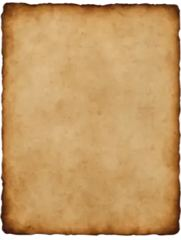 | [`parchment-a4.png`](originals/full-vision/parchment-a4.png) | `parchment-a4` | Not recorded | Unconfirmed |
| 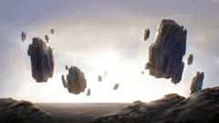 | [`boulders-ref.png`](originals/full-vision/boulders-ref.png) | `boulder-1` to `boulder-9` | Not recorded | Unconfirmed |
| 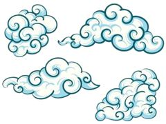 | [`cloud-a.png`](originals/full-vision/cloud-a.png) | `cloud-color-1` to `cloud-color-4` | Not recorded | Unconfirmed |
| 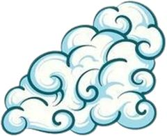 | [`cloud-color-3-edited.png`](originals/edited-by-author/cloud-color-3-edited.png) | `cloud-color-3`, hand-corrected by the author from `cloud-a.png` | Not recorded (see `cloud-a.png`) | Unconfirmed |
|  | [`cloud-textbox.png`](originals/full-vision/cloud-textbox.png) | `box-day`, `box-night` | Not recorded | Unconfirmed |
| 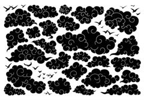 | [`dark-clouds.png`](originals/full-vision/dark-clouds.png) | `cloud-dark-1` to `cloud-dark-14` | Not recorded | Unconfirmed |
| 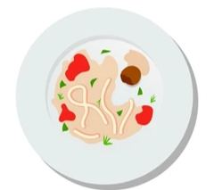 | [`feast-eaten.png`](originals/full-vision/feast-eaten.png) | `dish-eaten` | Not recorded | Unconfirmed |
| 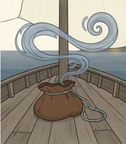 | [`bag-of-wind.png`](originals/full-vision/bag-of-wind.png) | `bag` | Not recorded | Unconfirmed |
| 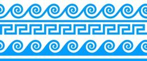 | [`sea-waves.png`](originals/full-vision/sea-waves.png) | Aeolus sea (`sea-left`, `sea-right`) and homepage (`home-wave-left`, `home-wave-right`, `home-key`) | Not recorded | Unconfirmed |
| 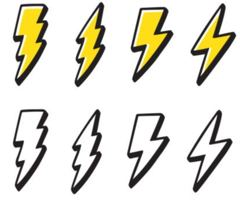 | [`lightning.png`](originals/full-vision/lightning.png) | `bolt-1` to `bolt-8` | Not recorded | Unconfirmed |
| 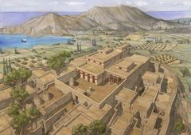 | [`ithaca-drawing.png`](originals/full-vision/ithaca-drawing.png) | `ithaca-land` | Not recorded | Unconfirmed |
| 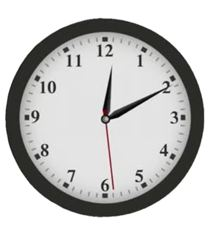 | [`clock.png`](originals/full-vision/clock.png) | `clock-face` | Not recorded | Unconfirmed |
|  | [`flower.gif`](originals/full-vision/flower.gif) | `flower-sprite` | Not recorded | Unconfirmed |
| 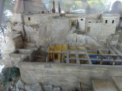 | [`ithaca-model-a.png`](originals/full-vision/ithaca-model-a.png) | Reference for Ithaca, not on the site. A model built by an architect, per the author's notes. | Not recorded | Unconfirmed |
| 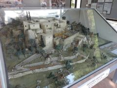 | [`ithaca-model-b.png`](originals/full-vision/ithaca-model-b.png) | Reference for Ithaca, not on the site. A model built by an architect, per the author's notes. | Not recorded | Unconfirmed |
| 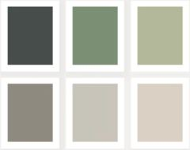 | [`i589-palette.png`](originals/full-vision/i589-palette.png) | Color reference for the Asylum form, not on the site. | Not recorded | Unconfirmed |

## Fonts

Not stored here. All are from Google Fonts under the [SIL Open Font License](https://openfontlicense.org/):

- [Fondamento](https://fonts.google.com/specimen/Fondamento) by Astigmatic
- [Pinyon Script](https://fonts.google.com/specimen/Pinyon+Script) by Nicole Fally
- [Commissioner](https://fonts.google.com/specimen/Commissioner) by Kostas Bartsokas
- [Faculty Glyphic](https://fonts.google.com/specimen/Faculty+Glyphic) by Koto Studio

## Edits on `on-site/`

The site's versions were made by cutting images out of their backgrounds, removing watermarks, recoloring to the design palette, separating frames and pieces, and cropping. `plate-rusted.webp` is shared under CC BY-SA 4.0, as its original requires.
